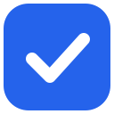
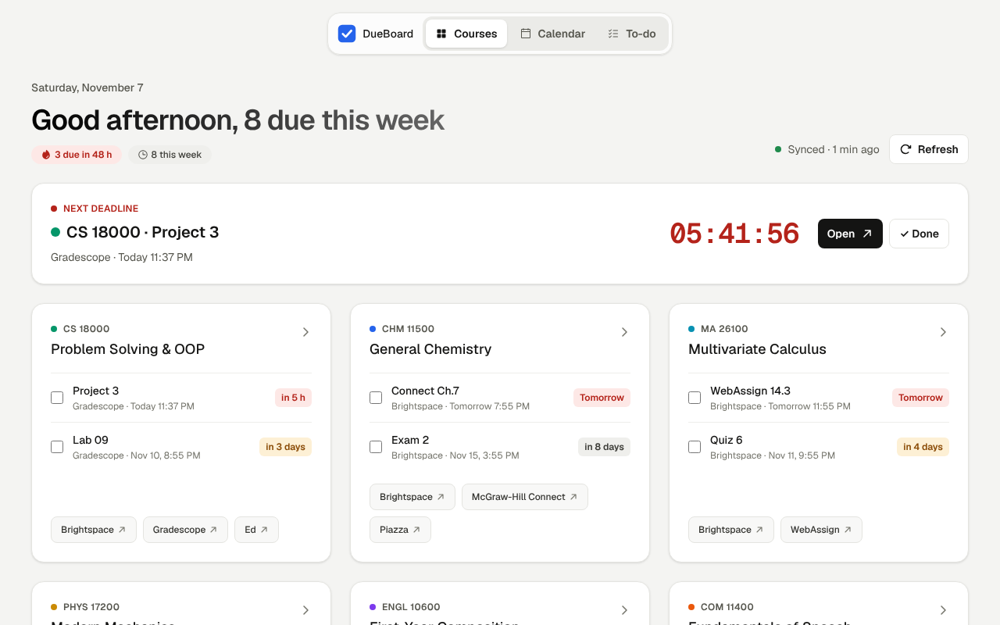

<p align="center"></p>

<h1 align="center">DueBoard</h1>

<p align="center">Every assignment, deadline and course platform from Brightspace — in one focused dashboard.</p>

<p align="center"></p>

> DueBoard is a student-built, open-source project and is **not affiliated with Purdue University, D2L Brightspace, Gradescope, Pearson, Wiley or any other platform it reads**.

## Why

At Purdue every course lives in Brightspace, but homework is spread across Gradescope, Pearson MyLab, WileyPLUS, ALEKS, InQuizitive, WebAssign and more — each with its own list of due dates. DueBoard collects them so you can see what is due next without clicking through every course.

## What it does

- **One sign-in.** You only sign in to Brightspace. DueBoard reads your courses and discovers which homework platforms they use.
- **Course cards.** Upcoming work per course with countdowns, plus one-click shortcuts to each course's platforms.
- **Next deadline.** The nearest deadline is emphasized at the top with a live countdown, an *Open* button and a *Done* button.
- **Calendar and to-do views.** Animated switching between course cards, week and month calendars, and a to-do list you can tick off, grouped into Overdue, Today, This week and Later with a count on each group.
- **Handed-in work ticks itself off, with its score.** Brightspace (your submission or gradebook grade), Gradescope, Pearson MyLab and other homework pages say whether you handed the work in; DueBoard ticks it off and shows the score. Untick something DueBoard ticked and it stays unticked.
- **Overdue for the whole term.** Every past-due assignment, quiz and homework since the course started, not only last week's. Work no source has said anything about moves into a collapsed **Not sure if handed in** section of the to-do list until one does, or until you tick it.
- **Focus timer.** A built-in Pomodoro timer on the dashboard and in the toolbar popup, with 25-minute focus sessions and 5-minute breaks by default (each adjustable from 1 to 180 minutes). Both share one timer, and a short chime plays when a session ends, even if DueBoard isn't open.
- **Study themes.** Switch between Nightowl, Morning Dew, Noon Cafe and Dusk Lullaby, or let Automatic choose for the time of day. Theme changes fade smoothly without interrupting your work.
- **Focused settings flow.** Settings open in the current DueBoard tab, with a back button that returns to the dashboard.
- **Any homework platform.** For homework that Brightspace launches on another platform, DueBoard opens your Brightspace link in a hidden frame inside the extension, reads the "Due …" line and closes it, in the background with no window or tab. Pages that can't be read that way fall back to a small minimized window (you can turn it off in Settings). Known platforms work out of the box; DueBoard asks you to allow a site only the first time it finds one it doesn't know.
- **Dates in titles.** A homework titled "HW11_due_Nov 11" gets that date.
- **Syllabus suggestions.** Dated work found in your syllabus (Simple Syllabus, or a PDF in Content), to add with one click.
- **Automatic sync** every 30 minutes, using the sessions already in your browser.
- **Chrome, Edge and Firefox** (and other Chromium browsers such as Brave, Arc and Opera).

### Dashboard themes

| Theme | Intended study time | Palette |
|---|---|---|
| Nightowl | 11 PM–5 AM | Low-glare violet navy for late-night work |
| Morning Dew | 5 AM–12 PM | Fresh mist, sky and sage for an early start |
| Noon Cafe | 12 PM–6 PM | Warm oat, coffee and apricot for afternoon study |
| Dusk Lullaby | 6 PM–11 PM | Aubergine, rose and muted sunset tones for the evening |
| Automatic | All day | Follows the schedule above and fades into the next theme |

Use the theme button in the dashboard header to cycle through all five choices. The selected theme is saved across reloads and can also be changed from **Settings → Appearance**. The toolbar popup follows the same theme.

### Where due dates come from

| Platform | How DueBoard gets the due date |
|---|---|
| Brightspace | Assignments, quizzes, calendar events and dated content items, read directly |
| Gradescope | Read from your Gradescope course pages when you are signed in |
| Pearson MyLab & Mastering | Read from MyLab when a course links to Pearson; if the session expired, DueBoard reopens it through Brightspace |
| WileyPLUS, ALEKS, Norton (InQuizitive, Smartwork), WebAssign, McGraw-Hill Connect, Achieve, Cengage, zyBooks, Top Hat, Perusall, Packback, Hawkes, Vista Higher Learning, Sapling, Expert TA, Knewton Alta, PrairieLearn, Vocareum, GoReact, LabFlow, BeyondLabz, Circuit, Variate | Read in the background from the assignment page your Brightspace homework link opens |
| Any other platform Brightspace launches | Same as above, once you allow the site the first time DueBoard finds it |
| Syllabus (Simple Syllabus, PDF or web page in Content) | Shown as suggestions you can add or hide |
| Anything else | Add it by hand; it stays until you remove it |

A date from Brightspace always wins over one read on a platform page, and every platform date says where it was read ("Read from ALEKS", shown when you hover over the item in the to-do list). The same sources say whether the work was handed in; a score of 0 on its own doesn't count, since platforms show 0 for missing work.

## Install

- **Chrome Web Store:** [Add to Chrome](https://chromewebstore.google.com/detail/lbmhglpjaedaijknkngdpoacagdgmoji) (also works in Microsoft Edge, Brave, Arc and Opera).
- **Firefox Add-ons:** link coming soon (needs Firefox 140 or later).
- **Manual install (testers, about two minutes):** follow the [illustrated install guide](https://yokiwa.github.io/dueboard/install.html). The same steps are in [docs/guide/01-install.md](docs/guide/01-install.md).

DueBoard currently supports `purdue.brightspace.com`.

## Privacy

- Everything stays in your browser. Nothing is uploaded, collected or analyzed.
- DueBoard never sees your password; it only reuses sessions your browser already has, and only sends read requests.
- Platform pages are opened only through your own Brightspace links and only read — DueBoard never types or submits anything. They load in hidden frames inside the extension (or, as a fallback, a small minimized window) and appear in your browser history like pages you open yourself.
- Timed or proctored exam tools (ExamSoft, Respondus LockDown Browser, Honorlock, Examity) are never opened automatically, so DueBoard never starts an exam attempt.
- Hidden frames can't open tabs or windows. While reading, DueBoard removes the "do not embed" headers only from its own hidden frame requests on homework sites; your own tabs are never affected.
- Uninstalling removes all data.
- Details: [privacy policy](docs/privacy.html).

## Development

Working on DueBoard with the team? Read [CONTRIBUTING.md](CONTRIBUTING.md) first (branches, pull requests, who owns which folder).

Requires Node.js 22.

```bash
npm install
```

```bash
npm run dev      # start Chrome with the extension in development mode
```

```bash
npm run compile  # type-check
```

```bash
npm test         # run the test suite
```

```bash
npm run build    # production build in .output/ (build:firefox for Firefox)
```

```bash
npm run zip           # build the zip for the Chrome Web Store
```

```bash
npm run zip:firefox   # build the Firefox zip and the source zip for Firefox Add-ons
```

```bash
npm run lint:firefox  # lint the Firefox build with web-ext (run build:firefox first)
```

```bash
npm run e2e:visits    # end-to-end check of platform visits in Chromium (needs Playwright)
```

```bash
npm run e2e:frames    # end-to-end check of background reading in hidden frames (needs Playwright)
```

Code lives in `src/` and tests in `tests/`, mirroring it; the folder map is in [docs/team/README.md](docs/team/README.md). Design notes and implementation plans are in [`docs/superpowers/`](docs/superpowers/), and design decisions in [docs/decisions.md](docs/decisions.md). Guides for installing, exporting sample pages, publishing, the beta, Firefox and the 1.4/1.5 trial are in [`docs/guide/`](docs/guide/). Changes in each version are in [CHANGELOG.md](CHANGELOG.md).

## Feedback

Missing assignments, wrong dates or a homework platform DueBoard doesn't know yet? Please open an [issue](../../issues).

## License

[MIT](LICENSE)
