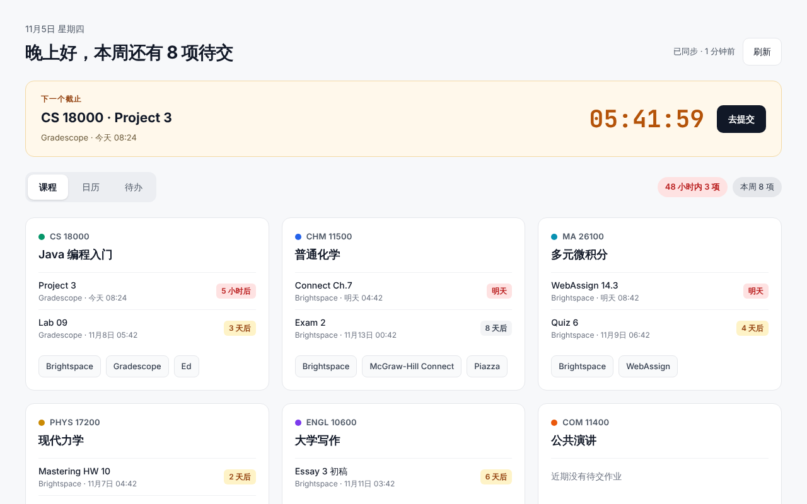

<p align="center"></p>

<h1 align="center">DueBoard</h1>

<p align="center">打开新标签页，就能看到所有课程的作业、截止日期和教材入口。<br>
All your Brightspace and Gradescope deadlines in one new tab.</p>

<p align="center"></p>

> DueBoard 是学生自己做的项目，**不是普渡大学（Purdue University）的官方产品**。
> DueBoard is a student project and is **not affiliated with Purdue University**.

## 它能做什么

- **一个页面看全部**：每门课一张卡片，显示接下来要交的作业和倒计时，以及 Brightspace、Gradescope、教材、讨论区等平台的一键入口。
- **下一个截止**：页面顶部永远显示最近的一个截止，带实时倒计时和“去提交”按钮。
- **日历和待办**：周视图 / 月视图一眼看出哪天作业扎堆；待办清单可以勾选“已完成”。
- **自动同步**：借用你浏览器里已有的登录状态，每 30 分钟从 Brightspace 和 Gradescope 读取一次。WebAssign 等平台的作业如果老师放进了 Brightspace 日历，也会自动出现；其余的可以手动添加。

## 安装

- **Chrome 应用商店**：上架后会在这里放链接。
- **手动安装测试版**：从 [Releases](../../releases) 下载 zip，按照 [指南 01](docs/guide/01-加载插件.md) 操作。

目前只支持 `purdue.brightspace.com` 和 `www.gradescope.com`。

## 隐私

- 所有数据只保存在你自己的浏览器里，**不上传、不收集、不分析**。
- 不接触你的密码，只复用浏览器已经登录的状态；只发送读取请求（GET）。
- 卸载插件后，所有数据随之删除。
- 详见 [隐私政策](docs/privacy.html)。

## 开发

需要 Node.js 22。

```bash
npm install
```

```bash
npm run dev      # 启动开发模式（自动打开带插件的 Chrome）
```

```bash
npm test         # 运行测试
```

```bash
npm run zip      # 打包成可以上传商店的 zip
```

代码结构和设计说明见 `docs/superpowers/specs/`（设计文档）和 `docs/superpowers/plans/`（开发计划）。

## 反馈

发现作业漏了、时间不对，或者有功能建议，欢迎在 [Issues](../../issues) 里提出。

## 许可

[MIT](LICENSE)
